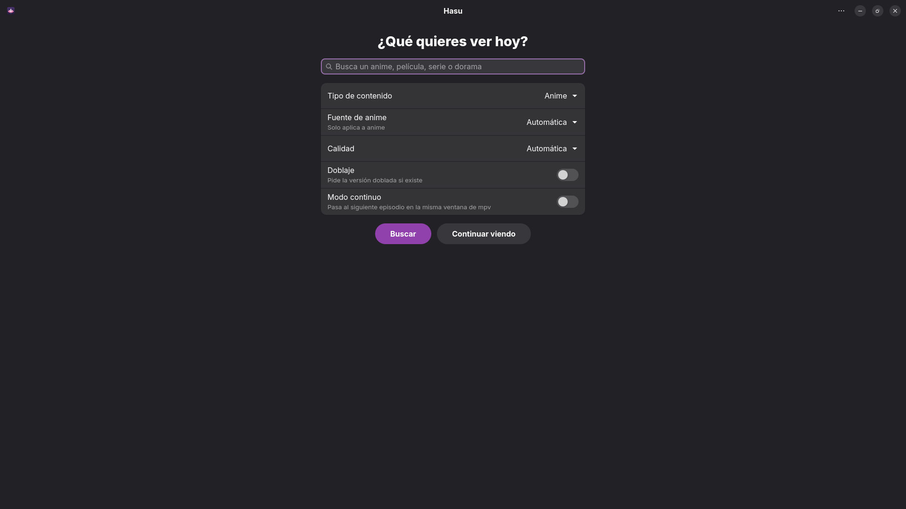

# Hasu

Interfaz gráfica ligera (GTK4 + libadwaita) para [ani-cli-mx](https://github.com/Gildedboy/ani-cli-mx).
Busca anime, películas, series y doramas, elige episodio y lo reproduce con mpv. Es mejor que usar un navegador web.
No solo por su bajo consumo de recursos (la app 200mb de ram aproximadante y los videos de los animes 300mb), sino
también la comodidad que ofrece para seguir viendo rápidamente tu contenido favorito sin abrir un navegador pesado.

  
  

## Cómo funciona

No reescribe ningún scraper. Ejecuta `ani-cli-mx --dmenu` y pone delante en el `PATH` un `dmenu`
falso (`hasu/dmenu_shim.py`). Cada menú que el script mostraría (resultados, episodios, fuente,
controles de reproducción…) llega a Hasu por un socket Unix; tu elección vuelve al script como si
fuera dmenu. Así las fuentes nuevas o arregladas en ani-cli-mx funcionan en Hasu sin tocar nada.

## Requisitos e Instalación Flatpak manual

Necesitarás instalar estos runtimes de Gnome:

    flatpak install --user flathub org.gnome.Sdk//51 org.gnome.Platform//51

Luego ve a releases, descarga el archivo io.github.Gustavomagno18.Hasu.flatpak, ejecutalo con tu tienda favorita (Bazaar, Gnome software, etcétera)
o instalalo desde la terminal en la carpeta donde lo descargaste con:

    flatpak install io.github.Gustavomagno18.Hasu.flatpak
    
Finalmente la buscas en tu lanzador de aplicaciones, la abres y a disfrutar de tus animes favoritos.

## Requisitos (Arch)

    sudo pacman -S python-gobject gtk4 libadwaita
    yay -S ani-cli-mx        # usa paru si no usas yay, trae mpv, curl, fzf, yt-dlp…
    
## 📥 Pasos para la instalación en tu terminal

    git clone https://github.com/Gustavomagno18/Hasu.git

## Probar sin instalar

    cd Hasu
    python -m hasu

## Instalar para tu usuario

    cd Hasu
    ./install-local.sh

## Instalar en el sistema (solo arch y derivados)

    cd Hasu/packaging/arch
    makepkg -si

## Apoyo

If you like **Hasu**, consider giving this repo a ⭐ on GitHub.  
You can also follow me for more Linux customizations:  
[GitHub Profile](https://github.com/Gustavomagno18)
    
## Pruebas

`tests/mock-ani-cli-mx` imita los menús del script real y `tests/ui_test.py` recorre la interfaz
(búsqueda → episodios → reproductor → atrás) con capturas:

    GSK_RENDERER=cairo xvfb-run -a python3 tests/ui_test.py

## Aviso

Hasu no aloja ni distribuye contenido. Respeta las leyes de derechos de autor de tu país.
Licencia: GPL-3.0-or-later (como ani-cli-mx).
